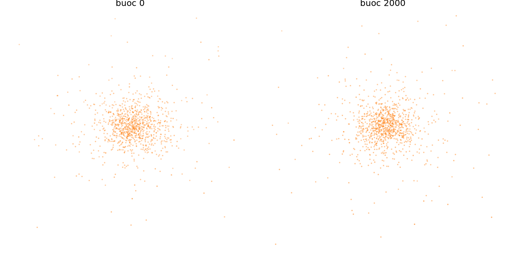
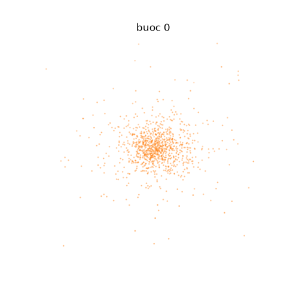

# Chương 2. Cơ sở lý thuyết và thuật toán tuần tự

*Người viết: Vũ Văn Dương*

## 2.1. Mô hình bài toán N-body

Xét hệ gồm \(N\) vật thể, vật thể \(i\) có khối lượng \(m_i\), vị trí \(\mathbf{r}_i\) và vận tốc \(\mathbf{v}_i\). Theo định luật vạn vật hấp dẫn Newton, lực tác dụng lên vật thể \(i\) là tổng lực do các vật thể còn lại gây ra. Viết dưới dạng gia tốc:

\[
\mathbf{a}_i
= G\sum_{j\ne i}m_j
\frac{\mathbf{r}_j-\mathbf{r}_i}
{\lVert\mathbf{r}_j-\mathbf{r}_i\rVert^3}.
\]

Trong công thức này, \(G\) là hằng số hấp dẫn. Khi mô phỏng trực tiếp, mỗi gia tốc cần xét gần \(N\) vật thể; tính gia tốc cho toàn hệ vì vậy cần \(N^2\) tương tác trong một bước thời gian. Đây là thuật toán *all-pairs*, có độ phức tạp \(O(N^2)\) mỗi bước.

## 2.2. Softening và năng lượng

Nếu hai vật thể tiến rất gần nhau, mẫu số của định luật Newton tiến về 0 và độ lớn gia tốc có thể tăng đột biến. Trong mô phỏng số, điều này khiến bước thời gian hữu hạn khó theo kịp tương tác ngắn, đồng thời làm kết quả nhạy với sai số làm tròn. Chương trình dùng tham số softening \(\varepsilon>0\) để thay thế khoảng cách trong mẫu số:

\[
\mathbf{a}_i
= G\sum_j m_j
\frac{\mathbf{r}_j-\mathbf{r}_i}
{\left(\lVert\mathbf{r}_j-\mathbf{r}_i\rVert^2+\varepsilon^2\right)^{3/2}}.
\]

Softening làm lực hữu hạn khi khoảng cách tiến về 0. Vì khi \(j=i\), vectơ \(\mathbf{r}_j-\mathbf{r}_i\) bằng 0, thành phần tự tương tác đóng góp 0; do đó vòng lặp có thể xét cả \(j=i\) mà không cần nhánh loại trừ. Trong cài đặt, \(\varepsilon^2\) được cộng vào bình phương khoảng cách trước khi tính nghịch đảo căn bậc hai.

Softening cũng thay đổi mô hình lực ở cự ly ngắn; nó không chỉ là một thủ thuật tính toán. Năng lượng thế được tính nhất quán với mô hình đã làm mềm:

\[
K = \frac{1}{2}\sum_i m_i\lVert\mathbf{v}_i\rVert^2,\qquad
U_\varepsilon = -G\sum_{i<j}
\frac{m_i m_j}{\sqrt{\lVert\mathbf{r}_i-\mathbf{r}_j\rVert^2+\varepsilon^2}},
\qquad E=K+U_\varepsilon.
\]

Thí nghiệm dùng độ lệch năng lượng tương đối giữa đầu và cuối mô phỏng:

\[
\left|\frac{\Delta E}{E_0}\right|
=\left|\frac{E_{\mathrm{cuối}}-E_0}{E_0}\right|.
\]

Đây là chỉ số kiểm tra mức bảo toàn năng lượng của tích phân số trong một lần chạy; nó không phải sai số vị trí của từng vật thể.

## 2.3. Tích phân Euler đối xứng

Gia tốc được tính từ vị trí tại đầu bước \(n\), sau đó cập nhật vận tốc rồi mới cập nhật vị trí:

\[
\mathbf{v}_{n+1}=\mathbf{v}_n+\mathbf{a}(\mathbf{r}_n)\Delta t,\qquad
\mathbf{r}_{n+1}=\mathbf{r}_n+\mathbf{v}_{n+1}\Delta t.
\]

Thứ tự cập nhật này được gọi là Euler đối xứng (*symplectic Euler*). Nó có bậc chính xác một theo bước thời gian, nhưng thường phù hợp hơn Euler tiến thông thường cho hệ cơ học bảo toàn vì giữ cấu trúc symplectic. Với \(\Delta t\) hữu hạn, năng lượng tính được vẫn có thể dao động hoặc lệch khỏi giá trị ban đầu; phương pháp không bảo đảm \(E_{\mathrm{cuối}}=E_0\) chính xác.

Trong chương trình, các thành phần vị trí, vận tốc và gia tốc được lưu bằng `float`. Năng lượng động học và thế năng được cộng dồn bằng `double` để hạn chế sai số tổng hợp. Khi so sánh các lần chạy, mỗi giá trị \(\varepsilon\) dùng năng lượng ban đầu và cuối được tính với chính giá trị softening đó.

## 2.4. Khởi tạo cụm sao Plummer

Để có trạng thái đầu vào tất định và có tính chất của một cụm sao, chương trình dùng mô hình Plummer. Mật độ khối lượng theo bán kính có dạng:

\[
\rho(r)=\frac{3M}{4\pi a^3}
\left(1+\frac{r^2}{a^2}\right)^{-5/2},
\]

trong đó \(M\) là tổng khối lượng và \(a\) là thang chiều dài. Nếu \(u\) là số ngẫu nhiên phân bố đều trong \((0,1)\), phép biến đổi nghịch đảo phân bố khối lượng tích lũy cho bán kính:

\[
r=\frac{a}{\sqrt{u^{-2/3}-1}}.
\]

Chương trình lấy hướng vị trí và hướng vận tốc phân bố trên mặt cầu, lấy độ lớn vận tốc bằng phép lấy mẫu loại bỏ, rồi dịch chuyển trạng thái để khối tâm ở gốc tọa độ và vận tốc khối tâm bằng 0. Khối lượng được chia đều, \(m_i=1/N\). Các phép lấy mẫu dùng bộ sinh SplitMix64 với seed mặc định 42, nhờ đó các thí nghiệm với tham số khác nhau bắt đầu từ cùng một trạng thái.

Mô phỏng dùng đơn vị N-body \(G=M=1\), với hệ số tỉ lệ vị trí \(3\pi/16\) và hệ số vận tốc tương ứng trong mã nguồn. Cách chuẩn hóa này giúp các đại lượng có độ lớn thuận tiện cho tính toán và so sánh.

## 2.5. Thuật toán tuần tự

Với mỗi vật thể \(i\), thuật toán duyệt toàn bộ \(N\) vật thể để cộng gia tốc. Sau khi hoàn tất gia tốc cho tất cả vật thể, một vòng lặp khác cập nhật vận tốc và vị trí. Tách hai pha bảo đảm mọi gia tốc trong bước hiện tại đều được tính từ cùng trạng thái vị trí trước khi tích phân.

```text
Khởi tạo pos[i], vel[i], mass[i] theo Plummer

Lặp step = 1 .. steps:
    Với i = 0 .. N-1:
        ax, ay, az = 0
        Với j = 0 .. N-1:
            dx, dy, dz = pos[j] - pos[i]
            d2 = dx*dx + dy*dy + dz*dz + eps*eps
            scale = G * mass[j] / (sqrt(d2) * d2)
            ax += dx * scale
            ay += dy * scale
            az += dz * scale
        acc[i] = (ax, ay, az)

    Với i = 0 .. N-1:
        vel[i] += acc[i] * dt
        pos[i] += vel[i] * dt
```

Mã thực thi gom phép tính trên thành phần vào hàm `nb_body_acc` và hàm cập nhật vào `nb_body_update` trong [`src/nbody_cpu_kernels.h`](../src/nbody_cpu_kernels.h). Phiên bản tuần tự gọi `nb_acc_serial`; vòng tương tác bên trong có thể được trình biên dịch vector hóa SIMD, nhưng không phân chia các vật thể \(i\) cho nhiều luồng.

### Độ phức tạp

- Tính gia tốc: \(N\) vật thể, mỗi vật thể xét \(N\) nguồn lực, nên cần \(O(N^2)\) phép tính mỗi bước.
- Cập nhật vận tốc và vị trí: \(O(N)\) mỗi bước.
- Lưu trạng thái: các mảng vị trí, vận tốc và gia tốc có tổng kích thước \(O(N)\).
- Tính năng lượng chẩn đoán: thế năng chỉ duyệt các cặp \(i<j\), nên vẫn có độ phức tạp \(O(N^2)\); năng lượng động học là \(O(N)\).

Theo quy ước của đề tài, một tương tác được tính xấp xỉ 20 phép toán dấu phẩy động. Do đó, phần tính lực chiếm ưu thế khi \(N\) lớn, còn các vòng cập nhật trạng thái tăng tuyến tính theo \(N\).

## 2.6. Phần có thể song song hóa và định luật Amdahl

Trong pha tính gia tốc, mỗi \(\mathbf{a}_i\) chỉ đọc mảng vị trí và khối lượng, đồng thời ghi vào ô `acc[i]` riêng. Vì vậy, các vòng tính cho những giá trị \(i\) khác nhau độc lập và có thể phân chia cho các luồng. Đây là phần song song dữ liệu chính của bài toán. Pha cập nhật cũng độc lập theo từng \(i\), miễn là mọi gia tốc của bước đó đã được tính xong.

Định luật Amdahl ước lượng giới hạn tăng tốc khi chỉ một phần chương trình được song song hóa:

\[
S(p)=\frac{1}{(1-P)+P/p},
\]

trong đó \(P\) là tỷ lệ thời gian có thể song song hóa và \(p\) là số luồng. Khi \(p\) tăng, phần tuần tự \(1-P\) vẫn giữ nguyên và trở thành giới hạn cho speedup. Với mô phỏng này, phép tính lực \(O(N^2)\) có thể song song hóa và chiếm tỷ lệ lớn khi \(N\) đủ lớn; tuy vậy, khởi tạo, điều phối luồng, ghi quỹ đạo và các phần tuần tự khác vẫn làm tốc độ thực tế thấp hơn giới hạn lý tưởng. Định luật Amdahl là mô hình lý tưởng hóa, chưa tính đầy đủ chi phí tạo luồng, đồng bộ và giới hạn băng thông bộ nhớ.

## 2.7. Thí nghiệm bảo toàn năng lượng

Các phép đo dưới đây dùng \(N=2048\), 2000 bước, seed 42, chế độ OpenMP với 12 luồng. Ở thí nghiệm `dt`, giữ \(\varepsilon=0.01\); ở thí nghiệm `eps`, giữ \(\Delta t=0.002\). Năng lượng được tính trước và sau mô phỏng bằng thế năng mềm \(U_\varepsilon\) nêu ở Mục 2.2.

| Thí nghiệm | Giá trị thay đổi | \(\Delta t\) | \(\varepsilon\) | \(|\Delta E/E_0|\) | Cấu hình máy |
|---|---:|---:|---:|---:|---|
| `dt` | 0.0005 | 0.0005 | 0.01 | 1.700e-05 | Intel Core i5-12450HX; 8 lõi/12 luồng; GCC 16.2; OpenMP 12 luồng |
| `dt` | 0.001 | 0.001 | 0.01 | 1.750e-06 | Intel Core i5-12450HX; 8 lõi/12 luồng; GCC 16.2; OpenMP 12 luồng |
| `dt` | 0.002 | 0.002 | 0.01 | 2.685e-06 | Intel Core i5-12450HX; 8 lõi/12 luồng; GCC 16.2; OpenMP 12 luồng |
| `dt` | 0.005 | 0.005 | 0.01 | 9.308e-05 | Intel Core i5-12450HX; 8 lõi/12 luồng; GCC 16.2; OpenMP 12 luồng |
| `dt` | 0.01 | 0.01 | 0.01 | 1.260e-03 | Intel Core i5-12450HX; 8 lõi/12 luồng; GCC 16.2; OpenMP 12 luồng |
| `eps` | 0.001 | 0.002 | 0.001 | 4.799e-03 | Intel Core i5-12450HX; 8 lõi/12 luồng; GCC 16.2; OpenMP 12 luồng |
| `eps` | 0.0031623 | 0.002 | 0.0031623 | 1.228e-04 | Intel Core i5-12450HX; 8 lõi/12 luồng; GCC 16.2; OpenMP 12 luồng |
| `eps` | 0.01 | 0.002 | 0.01 | 2.685e-06 | Intel Core i5-12450HX; 8 lõi/12 luồng; GCC 16.2; OpenMP 12 luồng |
| `eps` | 0.0316228 | 0.002 | 0.0316228 | 1.816e-05 | Intel Core i5-12450HX; 8 lõi/12 luồng; GCC 16.2; OpenMP 12 luồng |
| `eps` | 0.1 | 0.002 | 0.1 | 6.772e-06 | Intel Core i5-12450HX; 8 lõi/12 luồng; GCC 16.2; OpenMP 12 luồng |

Đồ thị log–log tương ứng được lưu tại [`results/vvduong_energy_dt.png`](../results/vvduong_energy_dt.png) và [`results/vvduong_energy_eps.png`](../results/vvduong_energy_eps.png). Dữ liệu thô, gồm cả cấu hình máy và tham số từng lần chạy, nằm trong [`results/vvduong_energy.csv`](../results/vvduong_energy.csv).

Khi tăng \(\Delta t\) từ 0.002 lên 0.005 và 0.01, độ lệch năng lượng cuối tăng từ \(2.685\times10^{-6}\) lên \(9.308\times10^{-5}\) và \(1.260\times10^{-3}\). Kết quả ở \(\Delta t=0.0005\) không nhỏ hơn mọi giá trị khác: \(1.700\times10^{-5}\), lớn hơn các giá trị tại 0.001 và 0.002. Điều này cho thấy độ lệch tại một thời điểm cuối không nhất thiết đơn điệu theo bước thời gian; năng lượng của tích phân symplectic có thể dao động và kết quả còn phụ thuộc pha tại thời điểm đo.

Trong phép quét softening, \(\varepsilon=0.001\) cho độ lệch lớn nhất \(4.799\times10^{-3}\), trong khi \(\varepsilon=0.01\) cho \(2.685\times10^{-6}\). Các điểm còn lại không tạo thành xu hướng đơn điệu. \(\varepsilon\) nhỏ làm lực ở cự ly gần nhạy hơn, còn \(\varepsilon\) lớn làm thay đổi đáng kể mô hình thế năng; vì vậy không thể suy ra một quy luật đơn giản chỉ từ một seed và một thời điểm cuối.

**Giới hạn của phép so sánh:** mỗi lần chạy dùng cùng 2000 bước. Vì vậy, khi thay đổi \(\Delta t\), tổng thời gian vật lý \(T=2000\Delta t\) cũng thay đổi (từ 1 đến 20 đơn vị thời gian). Các số liệu `dt` mô tả đúng cấu hình thí nghiệm đã chạy nhưng chưa phải phép so sánh sai số tại cùng một thời điểm vật lý. Một khảo sát hội tụ chặt chẽ hơn cần giữ \(T\) cố định và điều chỉnh số bước tỷ lệ nghịch với \(\Delta t\). Ngược lại, trong phép quét `eps`, \(\Delta t\) không đổi nên tổng thời gian mô phỏng bằng nhau.

## 2.8. Quỹ đạo mô phỏng

Quỹ đạo được tạo với \(N=1024\), 2000 bước, \(\Delta t=0.002\), \(\varepsilon=0.01\), lưu trạng thái mỗi 20 bước. Hình 2.3 so sánh trạng thái ban đầu và trạng thái ở bước 2000; ảnh động cho thấy diễn biến trung gian.



*Hình 2.3. Ảnh chụp cụm sao Plummer ở thời điểm đầu và cuối.*



*Hình 2.4. GIF quỹ đạo với 101 khung hình, từ bước 0 đến bước 2000.*

Tệp CSV quỹ đạo dùng để tái tạo hình và ảnh động: [`results/vvduong_energy_trajectory.csv`](../results/vvduong_energy_trajectory.csv).

## Tài liệu tham khảo

1. L. Nyland, M. Harris, J. Prins, “Fast N-Body Simulation with CUDA,” *GPU Gems 3*, Chương 31, NVIDIA.
2. S. J. Aarseth, M. Henon, R. Wielen, “Models for the dynamics of dense stellar systems,” *Astronomy and Astrophysics*, tập 37, 1974.
3. Mã nguồn mô phỏng của đề tài: [`src/nbody_common.h`](../src/nbody_common.h), [`src/nbody_cpu_kernels.h`](../src/nbody_cpu_kernels.h).
