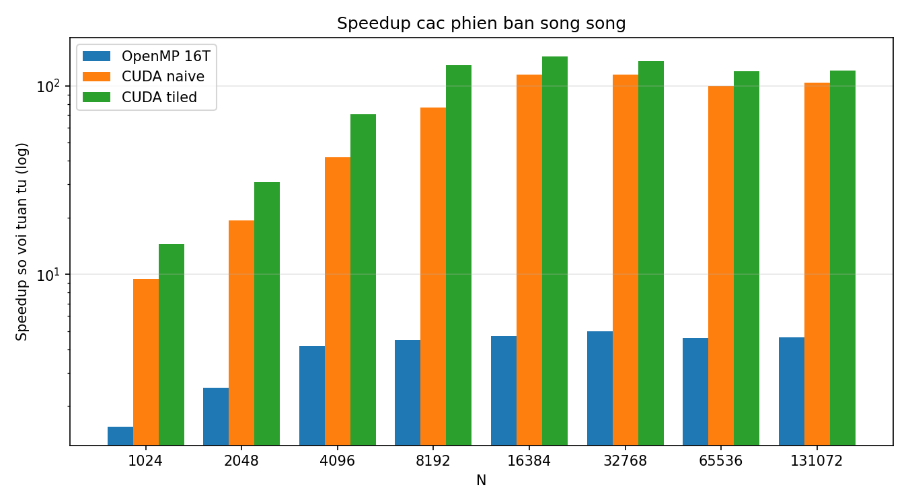
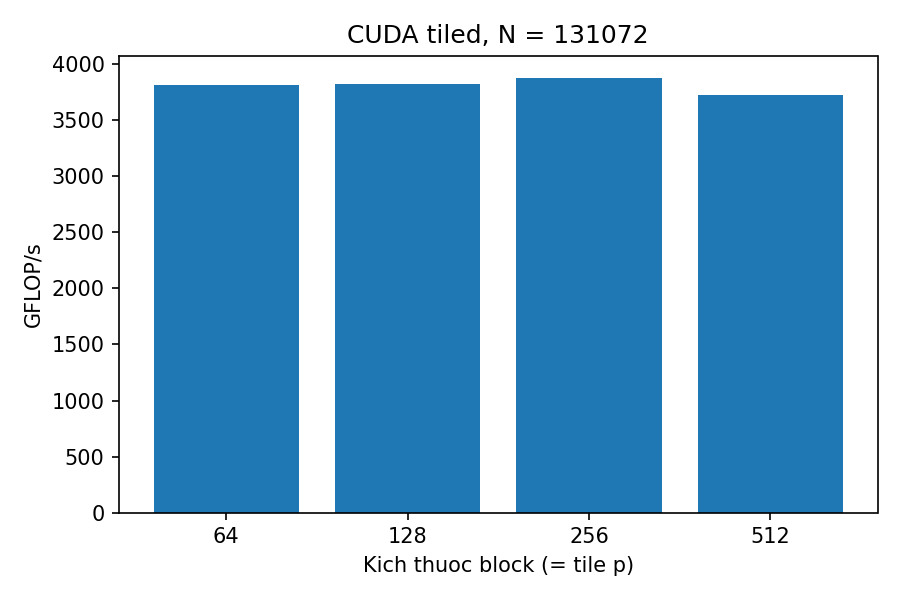

*Người viết: Trần Tiến Đạt*

# CHƯƠNG 4: SONG SONG HÓA BÀI TOÁN N-BODY TRÊN GPU VỚI CUDA

## 4.1. Kiến trúc GPU NVIDIA Tesla T4

Bài toán N-body được triển khai và thực nghiệm trên GPU **NVIDIA Tesla T4**, thuộc kiến trúc Turing, thông qua nền tảng Google Colab. Đây là GPU có khả năng xử lý song song cao, phù hợp với các bài toán có khối lượng tính toán lớn và mức độ song song dữ liệu cao.

Các thông số phần cứng quan trọng của NVIDIA Tesla T4:

- **Streaming Multiprocessor (SM):** GPU sở hữu 40 SM, mỗi SM có 64 nhân CUDA FP32, tổng cộng 2.560 nhân CUDA.
- **Hiệu năng tính toán FP32 lý thuyết:** Khoảng 8,1 TFLOP/s, tương đương 8.100 GFLOP/s.
- **Mô hình thực thi SIMT:** Các luồng CUDA được tổ chức thành những nhóm gọi là Warp, mỗi Warp gồm 32 luồng. Các luồng trong cùng một Warp thực thi cùng một lệnh tại một thời điểm.
- **Global Memory:** Bộ nhớ đồ họa có dung lượng 16 GB GDDR6, băng thông lý thuyết 320 GB/s. Đây là bộ nhớ có dung lượng lớn nhưng độ trễ truy cập cao hơn đáng kể so với bộ nhớ on-chip.
- **Shared Memory:** Bộ nhớ nằm trên chip, được chia sẻ giữa các luồng trong cùng một Thread Block. Trên Tesla T4, dung lượng Shared Memory tối đa được sử dụng trong cấu hình kiến trúc là khoảng 64 KB mỗi SM.
- **Registers:** Thanh ghi được cấp phát riêng cho từng luồng, có tốc độ truy cập rất cao và được sử dụng để lưu các biến trung gian trong quá trình tính toán.
- **L2 Cache:** Bộ nhớ đệm cấp hai có dung lượng 4 MB, hỗ trợ giảm số lần truy cập trực tiếp vào Global Memory.

Trong CUDA, GPU thực thi các luồng theo mô hình phân cấp Grid – Block – Thread. Việc tổ chức luồng và lựa chọn bộ nhớ phù hợp có ảnh hưởng trực tiếp đến hiệu năng của kernel. Đặc biệt, với bài toán N-body có độ phức tạp tính toán \(O(N^2)\), việc hạn chế các truy cập Global Memory dư thừa là một trong những hướng tối ưu quan trọng.

## 4.2. Ánh xạ bài toán và tổ chức Grid/Block

Bài toán N-body mô phỏng tương tác hấp dẫn giữa \(N\) vật thể. Mỗi vật thể chịu tác động của tất cả các vật thể còn lại, do đó số lượng tương tác cần tính toán tăng theo bình phương số vật thể, tương ứng với độ phức tạp \(O(N^2)\).

Để khai thác khả năng xử lý song song của GPU, chương trình sử dụng chiến lược **mỗi CUDA Thread phụ trách tính toán cho một vật thể đích (target body)**.

### 4.2.1. Tổ chức Grid và Block

Tập hợp \(N\) vật thể được chia thành các Thread Block một chiều. Mỗi Block chứa \(B\) luồng, trong đó \(B\) là kích thước Block (`blockDim.x`).

Số lượng Block cần khởi tạo được xác định theo công thức:

\[
gridDim.x = \left\lceil \frac{N}{B} \right\rceil
= \frac{N+B-1}{B}
\]

Chương trình khảo sát các kích thước Block:

\[
B \in \{64,128,256,512\}
\]

Mỗi luồng xác định chỉ số vật thể mà mình phụ trách thông qua:

\[
i = blockIdx.x \times blockDim.x + threadIdx.x
\]

Trong đó:

- `blockIdx.x`: Chỉ số của Block trong Grid.
- `blockDim.x`: Số lượng luồng trong mỗi Block.
- `threadIdx.x`: Chỉ số của luồng bên trong Block.
- \(i\): Chỉ số vật thể đích mà luồng chịu trách nhiệm tính toán.

Do số lượng luồng được khởi tạo có thể lớn hơn số vật thể cần xử lý, chương trình cần kiểm tra điều kiện \(i < N\) trước khi thực hiện tính toán để tránh truy cập ngoài phạm vi dữ liệu.

### 4.2.2. Tính độc lập giữa các luồng

Mỗi luồng đọc dữ liệu vị trí và khối lượng của toàn bộ các vật thể nguồn, sau đó tính gia tốc cho một vật thể đích duy nhất. Kết quả được ghi vào phần tử tương ứng trong mảng gia tốc.

Do mỗi luồng chỉ ghi kết quả vào một vị trí riêng biệt, các luồng không xảy ra xung đột khi ghi dữ liệu. Vì vậy, trong bước tính gia tốc này, chương trình không cần sử dụng các phép toán nguyên tử như `atomicAdd`.

Cách ánh xạ này giúp phân chia công việc rõ ràng, khai thác tính song song dữ liệu và tạo cơ sở để triển khai hai phiên bản kernel Naive và Tiled.

## 4.3. Kernel Naive và nút thắt cổ chai bộ nhớ toàn cục

### 4.3.1. Nguyên lý hoạt động

Kernel Naive là cách triển khai trực tiếp bài toán N-body trên GPU. Mỗi luồng phụ trách một vật thể đích \(i\), trước tiên đọc vị trí của vật thể này vào thanh ghi, sau đó duyệt qua toàn bộ \(N\) vật thể nguồn \(j\) để tính tổng gia tốc.

Quá trình tính toán bao gồm các bước:

1. Xác định chỉ số vật thể đích \(i\) mà luồng phụ trách.
2. Kiểm tra điều kiện \(i < N\).
3. Đọc vị trí và khối lượng của vật thể đích.
4. Duyệt qua toàn bộ các vật thể nguồn.
5. Tính khoảng cách, nghịch đảo khoảng cách và lực tương tác.
6. Cộng dồn gia tốc và ghi kết quả vào mảng đầu ra.

### 4.3.2. Mã nguồn kernel Naive

```cuda
__global__ void compute_forces_naive(
    const float4* pos,
    float3* acc,
    int N,
    float eps2
) {
    int i = blockIdx.x * blockDim.x + threadIdx.x;
    if (i >= N) return;

    float4 myPos = pos[i];
    float3 a = {0.0f, 0.0f, 0.0f};

    for (int j = 0; j < N; j++) {
        float4 otherPos = pos[j];

        float dx = otherPos.x - myPos.x;
        float dy = otherPos.y - myPos.y;
        float dz = otherPos.z - myPos.z;

        float distSqr =
            dx * dx + dy * dy + dz * dz + eps2;

        float invDist = rsqrtf(distSqr);
        float invDist3 = invDist * invDist * invDist;

        float s = otherPos.w * invDist3;

        a.x += dx * s;
        a.y += dy * s;
        a.z += dz * s;
    }

    acc[i] = a;
}
```

Trong cấu trúc dữ liệu `float4`, ba thành phần \(x,y,z\) biểu diễn tọa độ không gian của vật thể, còn thành phần \(w\) lưu khối lượng. Hàm `rsqrtf()` được sử dụng để tính nghịch đảo căn bậc hai, phục vụ quá trình xác định lực tương tác.

### 4.3.3. Phân tích nút thắt cổ chai bộ nhớ (Memory-Bound)

Mặc dù cách triển khai Naive có cấu trúc đơn giản và khai thác được tính song song của GPU, phương pháp này vẫn tồn tại hạn chế lớn về truy cập bộ nhớ.

**Thứ nhất, số lượng truy cập Global Memory lớn.**

Với mỗi cặp tương tác \((i,j)\), luồng tính toán cần dữ liệu của vật thể nguồn. Mỗi phần tử `float4` có kích thước 16 bytes. Với \(N\) vật thể, tổng số lần đọc dữ liệu theo mô hình truy cập trực tiếp có thể lên tới \(N^2\), tương ứng với lưu lượng dữ liệu lý thuyết:

\[
Memory\ Traffic \approx 16N^2 \text{ bytes}
\]

Trong khi đó, dữ liệu vị trí của toàn bộ \(N\) vật thể chỉ chiếm \(16N\) bytes. Điều này cho thấy cùng một dữ liệu nguồn có thể bị nhiều luồng đọc lặp lại trong quá trình tính toán. Trên thực tế, Cache có thể giảm một phần số lần truy cập VRAM, nhưng cách triển khai Naive vẫn phụ thuộc đáng kể vào hệ thống bộ nhớ.

**Thứ hai, Arithmetic Intensity thấp.**

Arithmetic Intensity là tỷ lệ giữa số phép toán dấu phẩy động và lượng dữ liệu cần truy cập từ bộ nhớ:

\[
AI = \frac{FLOPs}{Bytes}
\]

Theo ước tính trong bài toán, mỗi tương tác cần khoảng 20 phép toán dấu phẩy động và 16 bytes dữ liệu:

\[
AI = \frac{20}{16} = 1,25 \text{ FLOP/byte}
\]

Trong khi đó, để khai thác tương ứng mức hiệu năng FP32 lý thuyết 8.100 GFLOP/s và băng thông bộ nhớ 320 GB/s của Tesla T4, mức Arithmetic Intensity cần đạt xấp xỉ:

\[
AI_{required} = \frac{8100}{320}
\approx 25,3 \text{ FLOP/byte}
\]

Mức Arithmetic Intensity thấp cho thấy kernel Naive có nguy cơ bị giới hạn bởi khả năng cung cấp dữ liệu của bộ nhớ, khiến các nhân CUDA không thể duy trì mức sử dụng tối đa.

Vì vậy, cần một phương pháp tối ưu nhằm giảm số lần đọc dữ liệu từ Global Memory. Đây là cơ sở để áp dụng kỹ thuật Shared Memory Tiling trong kernel Tiled.

## 4.4. Kernel Tiled sử dụng Shared Memory (GPU Gems 3, Chương 31)

### 4.4.1. Ý tưởng tối ưu bằng Tiling

Để khắc phục hạn chế của kernel Naive, chương trình áp dụng kỹ thuật **Tiling (chia dữ liệu thành các Tile)** dựa trên phương pháp được trình bày trong GPU Gems 3, Chương 31.

Ý tưởng chính của kỹ thuật này là tận dụng khả năng chia sẻ dữ liệu giữa các luồng trong cùng một Thread Block. Thay vì để mỗi luồng liên tục đọc dữ liệu vật thể nguồn từ Global Memory, các luồng trong Block phối hợp nạp một nhóm vật thể vào Shared Memory. Sau đó, toàn bộ luồng trong Block cùng sử dụng dữ liệu đã được nạp để thực hiện tính toán.

Với kích thước Block là \(B\), tập hợp \(N\) vật thể nguồn được chia thành:

\[
numTiles = \left\lceil \frac{N}{B} \right\rceil
\]

Tile cuối cùng có thể chứa ít hơn \(B\) vật thể nếu \(N\) không chia hết cho \(B\).

**Sơ đồ cơ chế hoạt động của Tiled:**

```text
                  GLOBAL MEMORY
        N vật thể nguồn được chia thành Tile
      +----------+----------+----------+------+
      |  Tile 0  |  Tile 1  |  Tile 2  | ...  |
      |    B     |    B     |    B     |      |
      +----------+----------+----------+------+
                   |
                   | B luồng phối hợp nạp B phần tử
                   v
                 SHARED MEMORY
             +-------------------+
             |  shPos[0 ... B-1] |
             +-------------------+
                   |
                   | B luồng cùng đọc và tái sử dụng
                   v
                 REGISTERS
        +-----------------------------+
        | Thread 0: tích lũy gia tốc  |
        | Thread 1: tích lũy gia tốc  |
        | Thread 2: tích lũy gia tốc  |
        | ...                         |
        | Thread B-1: tích lũy gia tốc|
        +-----------------------------+
                   |
                   v
              OUTPUT: acc[i]
```

### 4.4.2. Cơ chế nạp và tái sử dụng dữ liệu

Tại mỗi vòng lặp Tile, các luồng trong Block phối hợp nạp dữ liệu từ Global Memory vào mảng Shared Memory:

```cuda
__shared__ float4 shPos[BLOCK_SIZE];
```

Mỗi luồng chịu trách nhiệm nạp một phần tử. Các luồng liền kề truy cập những địa chỉ bộ nhớ liên tiếp, giúp tận dụng cơ chế gộp giao dịch bộ nhớ (Memory Coalescing).

Sau khi dữ liệu được nạp vào Shared Memory, mỗi luồng sử dụng lại toàn bộ \(B\) phần tử trong Tile để tính tương tác với vật thể đích mà nó phụ trách.

Như vậy, thay vì mỗi luồng tự đọc lại dữ liệu vật thể nguồn từ Global Memory, một Tile gồm \(B\) vật thể chỉ cần được nạp một lần cho toàn bộ Block. Các luồng trong Block có thể cùng tái sử dụng dữ liệu này.

Theo mô hình truy cập lý tưởng, lượng dữ liệu nguồn cần nạp từ Global Memory giảm từ khoảng \(N^2\) xuống \(N^2/B\) phần tử, tương ứng mức giảm xấp xỉ \(B\) lần. Hiệu quả thực tế còn phụ thuộc vào Cache, chi phí đồng bộ hóa và cách trình biên dịch tối ưu mã nguồn.

### 4.4.3. Vai trò của hai lệnh `__syncthreads()`

Trong kernel Tiled, lệnh đồng bộ hóa `__syncthreads()` được sử dụng hai lần trong mỗi vòng lặp Tile. Hai lần đồng bộ này đảm bảo các luồng trong cùng một Block phối hợp chính xác khi đọc và ghi dữ liệu Shared Memory.

```cuda
for (int tile = 0; tile < numTiles; tile++) {
    int idx = tile * blockDim.x + threadIdx.x;

    shPos[threadIdx.x] =
        (idx < N) ? pos[idx] : make_float4(0, 0, 0, 0);

    __syncthreads();

    for (int j = 0; j < blockDim.x; j++) {
        // Tính tương tác giữa myPos và shPos[j]
    }

    __syncthreads();
}
```

**Lần đồng bộ thứ nhất – Sau khi nạp dữ liệu (RAW: Read After Write).**

Sau khi các luồng ghi dữ liệu vào Shared Memory, `__syncthreads()` đảm bảo toàn bộ luồng trong Block đã hoàn tất việc nạp dữ liệu trước khi bất kỳ luồng nào bắt đầu đọc `shPos[j]`.

Nếu thiếu lệnh đồng bộ này, một số Warp có thể bắt đầu đọc Shared Memory trong khi các Warp khác vẫn đang ghi dữ liệu. Điều đó có thể khiến chương trình đọc phải dữ liệu chưa được cập nhật hoặc dữ liệu cũ.

**Lần đồng bộ thứ hai – Sau khi hoàn tất tính toán (WAR: Write After Read).**

Sau khi tất cả các luồng sử dụng xong dữ liệu của Tile hiện tại, lệnh `__syncthreads()` thứ hai đảm bảo không còn luồng nào đang đọc dữ liệu trong Shared Memory trước khi Tile tiếp theo được nạp và ghi đè lên vùng nhớ đó.

Nếu thiếu lệnh này, một số Warp có thể chuyển sang Tile tiếp theo và ghi dữ liệu mới trong khi các Warp khác vẫn đang sử dụng dữ liệu cũ. Đây là nguy cơ xảy ra xung đột Write After Read.

Như vậy, hai lệnh đồng bộ có vai trò khác nhau nhưng đều cần thiết: lần thứ nhất bảo đảm dữ liệu đã được nạp đầy đủ trước khi đọc; lần thứ hai bảo đảm dữ liệu cũ đã được sử dụng xong trước khi ghi đè dữ liệu mới.

## 4.5. Kết quả thực nghiệm trên NVIDIA Tesla T4

### 4.5.1. Cấu hình thực nghiệm

Các thử nghiệm được thực hiện trên nền tảng Google Colab với cấu hình phần cứng và phần mềm như sau:

| Thành phần | Thông số |
|---|---|
| GPU | NVIDIA Tesla T4 |
| Kiến trúc | Turing |
| VRAM | 16 GB GDDR6 |
| Driver | 580.82.07 |
| CUDA Toolkit | CUDA 13.0 |
| Trình biên dịch | nvcc |
| Cờ tối ưu | -O3 |
| Độ chính xác | FP32 |
| CPU | Intel Xeon CPU @ 2.00GHz |
| Hệ điều hành | Linux 6.6.159+ |
| Trình biên dịch CPU | gcc 13.3.0 |

Đối với benchmark so sánh Naive và Tiled, chương trình sử dụng:

- Số bước mô phỏng: `STEPS = 5`.
- Số lần lặp đo: `REPS = 3`.
- Số vật thể khảo sát: \(N \in \{1024, 2048, 4096, 8192, 16384, 32768, 65536, 131072\}\).
- Kích thước Block khảo sát: \(B \in \{64,128,256,512\}\).

Đối với log đo riêng CUDA Tiled và chi phí truyền dữ liệu, chương trình sử dụng `steps = 10`, `blockSize = 256`.

### 4.5.2. So sánh hiệu năng giữa OpenMP, CUDA Naive và CUDA Tiled

Biểu đồ dưới đây thể hiện tốc độ tăng tốc (Speedup) của ba phương pháp: OpenMP 16 luồng, CUDA Naive và CUDA Tiled theo số lượng vật thể \(N\). Trục tung được biểu diễn theo thang logarit nhằm thể hiện rõ sự chênh lệch hiệu năng giữa các phương pháp.



*Hình 4.1. So sánh tốc độ tăng tốc giữa các phương pháp song song.*

Quan sát biểu đồ cho thấy hai phương pháp triển khai trên GPU có ưu thế rõ rệt so với OpenMP 16 luồng khi số lượng vật thể tăng. Trong đó, CUDA Tiled đạt mức Speedup cao nhất trong các phương pháp được thể hiện trên biểu đồ.

So sánh giữa hai phiên bản CUDA, Tiled có tốc độ tăng tốc cao hơn Naive ở các kích thước bài toán được khảo sát. Nguyên nhân chủ yếu là Tiled sử dụng Shared Memory để tái sử dụng dữ liệu nguồn giữa các luồng trong cùng một Block, qua đó giảm áp lực truy cập Global Memory.

Đáng chú ý, khi số lượng vật thể tăng, khoảng cách hiệu năng giữa các phương pháp ngày càng thể hiện rõ. Điều này cho thấy khả năng khai thác song song dữ liệu của GPU phù hợp với đặc điểm tính toán có độ phức tạp \(O(N^2)\) của bài toán N-body.

Biểu đồ sử dụng trục tung dạng logarit, do đó cần lưu ý rằng khoảng cách trực quan giữa các cột không biểu diễn mức chênh lệch tuyệt đối theo thang tuyến tính.

### 4.5.3. So sánh thời gian thực thi và hiệu năng: Naive vs. Tiled

Thử nghiệm so sánh hai kernel được thực hiện với `blockSize = 256`, `steps = 5`. Bảng dưới đây thể hiện thời gian thực thi cho 5 bước mô phỏng, tốc độ tăng tốc và hiệu năng tính toán tương ứng.

| Số vật thể (N) | Naive (ms/5 bước) | Tiled (ms/5 bước) | Speedup | Naive (GFLOP/s) | Tiled (GFLOP/s) |
|---:|---:|---:|---:|---:|---:|
| 1.024 | 0,315 | 0,205 | 1,54x | 332,54 | 511,52 |
| 2.048 | 0,625 | 0,391 | 1,60x | 670,93 | 1.073,74 |
| 4.096 | 1,277 | 0,751 | 1,70x | 1.313,48 | 2.233,39 |
| 8.192 | 2,489 | 1,491 | 1,67x | 2.696,09 | 4.501,10 |
| 16.384 | 7,214 | 5,741 | 1,26x | 3.720,98 | 4.675,87 |
| 32.768 | 28,685 | 24,457 | 1,17x | 3.743,21 | 4.390,29 |
| 65.536 | 131,047 | 109,366 | 1,20x | 3.277,41 | 3.927,16 |
| 131.072 | 515,285 | 442,754 | 1,16x | 3.334,05 | 3.880,23 |

Kết quả cho thấy kernel Tiled có thời gian thực thi thấp hơn kernel Naive ở tất cả các kích thước bài toán được khảo sát. Mức tăng tốc dao động từ 1,16x đến 1,70x. Hiệu quả cải thiện rõ nhất tại \(N=4.096\), với tốc độ tăng tốc 1,70x.

Về hiệu năng tính toán, Tiled đạt mức cao nhất 4.675,87 GFLOP/s tại \(N=16.384\), trong khi Naive đạt 3.743,21 GFLOP/s tại \(N=32.768\). Điều này cho thấy việc khai thác Shared Memory giúp tăng khả năng tái sử dụng dữ liệu và giảm áp lực truy cập Global Memory.

Tuy nhiên, mức tăng tốc có xu hướng thu hẹp khi số lượng vật thể tăng lớn. Tại \(N=32.768\), \(65.536\) và \(131.072\), mức tăng tốc lần lượt là 1,17x, 1,20x và 1,16x. Một nguyên nhân có thể là bộ nhớ đệm L2 của Tesla T4 hỗ trợ giữ lại một phần dữ liệu được truy cập lặp lại, giúp giảm chi phí truy cập Global Memory của kernel Naive. Bên cạnh đó, Tiled cũng phải trả thêm chi phí cho hoạt động nạp dữ liệu và đồng bộ hóa giữa các luồng.

Dù vậy, Tiled vẫn duy trì ưu thế về thời gian thực thi trên toàn bộ các cấu hình thử nghiệm.

### 4.5.4. Ảnh hưởng của kích thước Block (Block Size)

Để xác định kích thước Block phù hợp, chương trình tiến hành thử nghiệm bốn cấu hình \(B=64,128,256,512\) tại \(N=131.072\).

Thời gian thực thi trong bảng được tính cho 5 bước mô phỏng (STEPS = 5).

| Block Size (B) | Thời gian thực thi (ms/5 bước) | Thông lượng tương tác (GInter/s) | Hiệu năng (GFLOP/s) |
|---:|---:|---:|---:|
| 64 | 450,288 | 190,77 | 3.815,31 |
| 128 | 449,339 | 191,17 | 3.823,36 |
| 256 | 442,754 | 194,01 | 3.880,23 |
| 512 | 460,908 | 186,37 | 3.727,40 |



*Hình 4.2. Ảnh hưởng của Block Size đến hiệu năng kernel Tiled.*

Kết quả thực nghiệm cho thấy cấu hình **Block Size = 256** đạt hiệu năng tốt nhất, với thời gian thực thi 442,754 ms và hiệu năng 3.880,23 GFLOP/s.

Ở cấu hình \(B=64\) và \(B=128\), thời gian thực thi lần lượt là 450,288 ms và 449,339 ms. Hai cấu hình này có hiệu năng thấp hơn một chút do số lượng vật thể được tái sử dụng trong mỗi Tile ít hơn so với \(B=256\).

Ngược lại, khi tăng kích thước Block lên 512, thời gian thực thi tăng lên 460,908 ms và hiệu năng giảm còn 3.727,40 GFLOP/s. Điều này cho thấy việc tăng kích thước Block không phải lúc nào cũng mang lại hiệu quả. Block quá lớn có thể làm tăng mức sử dụng tài nguyên trên mỗi SM và ảnh hưởng đến khả năng duy trì nhiều Block hoạt động đồng thời (occupancy).

Như vậy, trong phạm vi các cấu hình được khảo sát, \(B=256\) là lựa chọn phù hợp nhất cho kernel Tiled trên Tesla T4 tại \(N=131.072\).

### 4.5.5. Đánh giá hiệu năng CUDA Tiled với 10 bước mô phỏng

Bên cạnh benchmark so sánh Naive và Tiled với 5 bước mô phỏng, chương trình còn thực hiện một lần đo riêng đối với CUDA Tiled với `steps = 10`, `blockSize = 256`.

Kết quả được trích xuất từ log thực nghiệm:

| Số vật thể (N) | Kernel (ms) | H2D (ms) | D2H (ms) | Hiệu năng (GFLOP/s) |
|---:|---:|---:|---:|---:|
| 4.096 | 2,569 | 0,090 | 0,066 | 1.306,181 |
| 16.384 | 15,663 | 0,288 | 0,178 | 3.427,615 |
| 65.536 | 212,138 | 0,780 | 0,684 | 4.049,227 |
| 131.072 | 839,962 | 1,230 | 1,231 | 4.090,632 |

Kết quả cho thấy hiệu năng tính toán của kernel Tiled tăng theo quy mô bài toán trong phạm vi các cấu hình được khảo sát. Cụ thể, tại \(N=4.096\), kernel đạt 1.306,18 GFLOP/s; khi tăng lên \(N=131.072\), hiệu năng đạt 4.090,63 GFLOP/s.

Tại các kích thước lớn, hiệu năng đạt được tương đối ổn định, dao động quanh mức 4.000 GFLOP/s. Điều này cho thấy kernel Tiled có khả năng khai thác tài nguyên GPU hiệu quả khi khối lượng tính toán đủ lớn.

Cần phân biệt bảng này với bảng so sánh Naive và Tiled ở mục 4.5.3. Đây là kết quả của một lần đo riêng với 10 bước mô phỏng, do đó không sử dụng để thay thế trực tiếp các số liệu benchmark 5 bước trước đó.

### 4.5.6. Chi phí truyền dữ liệu Host-to-Device và Device-to-Host

Bên cạnh thời gian tính toán của kernel, chi phí truyền dữ liệu giữa CPU và GPU cũng là yếu tố cần xem xét khi đánh giá hiệu năng tổng thể.

- **H2D (Host-to-Device):** Thời gian truyền dữ liệu từ bộ nhớ CPU sang bộ nhớ GPU.
- **D2H (Device-to-Host):** Thời gian truyền dữ liệu từ bộ nhớ GPU về bộ nhớ CPU.

Thử nghiệm đo chi phí truyền dữ liệu được thực hiện với `steps = 10` và `blockSize = 256`.

| Số vật thể (N) | H2D (ms) | D2H (ms) | Tổng H2D + D2H (ms) | Kernel (ms) | Tổng thời gian (ms) | Tỷ lệ truyền dữ liệu (%) |
|---:|---:|---:|---:|---:|---:|---:|
| 4.096 | 0,090 | 0,066 | 0,156 | 2,569 | 2,725 | 5,72% |
| 16.384 | 0,288 | 0,178 | 0,466 | 15,663 | 16,129 | 2,89% |
| 65.536 | 0,780 | 0,684 | 1,464 | 212,138 | 213,602 | 0,69% |
| 131.072 | 1,230 | 1,231 | 2,461 | 839,962 | 842,423 | 0,29% |

Kết quả cho thấy thời gian truyền dữ liệu tăng khi số lượng vật thể tăng. Tuy nhiên, tỷ trọng chi phí truyền dữ liệu trong tổng thời gian thực thi lại giảm đáng kể, từ 5,72% tại \(N=4.096\) xuống còn 0,29% tại \(N=131.072\).

Nguyên nhân là do chi phí truyền dữ liệu có xu hướng tăng theo quy mô dữ liệu \(O(N)\), trong khi khối lượng tính toán của bài toán N-body tăng theo \(O(N^2)\). Khi số lượng vật thể lớn, thời gian tính toán kernel chiếm phần áp đảo trong tổng thời gian thực thi.

Tại \(N=131.072\), tổng thời gian truyền dữ liệu chỉ là 2,461 ms, trong khi thời gian thực thi kernel là 839,962 ms. Điều này cho thấy phần lớn thời gian thực thi được dành cho tính toán trên GPU thay vì truyền dữ liệu giữa CPU và GPU.

Vì vậy, việc giữ dữ liệu trên VRAM trong suốt nhiều bước mô phỏng có ý nghĩa quan trọng. Nếu phải liên tục truyền dữ liệu qua lại giữa CPU và GPU ở mỗi bước, chi phí truyền dữ liệu có thể làm giảm hiệu quả của quá trình tính toán song song.

## 4.6. Nhận xét và đánh giá hiệu năng

### 4.6.1. Hiệu quả của kỹ thuật Shared Memory Tiling

Kết quả thực nghiệm chứng minh kernel Tiled có hiệu năng tốt hơn kernel Naive trên toàn bộ các kích thước bài toán được khảo sát. Mức tăng tốc đạt từ 1,16x đến 1,70x, trong đó hiệu quả rõ nhất xuất hiện tại \(N=4.096\) và \(N=8.192\).

Nguyên nhân chủ yếu đến từ khả năng tái sử dụng dữ liệu của Shared Memory. Thay vì để từng luồng liên tục đọc dữ liệu vật thể nguồn từ Global Memory, Tiled cho phép các luồng trong cùng Block cùng sử dụng dữ liệu đã được nạp vào Shared Memory. Nhờ đó, số lần nạp dữ liệu nguồn từ Global Memory được giảm đáng kể theo mô hình Tiling.

Tuy nhiên, hiệu quả tối ưu không tăng tuyến tính theo kích thước bài toán. Ở các cấu hình có số lượng vật thể lớn, bộ nhớ đệm L2 có thể hỗ trợ kernel Naive giảm một phần chi phí truy cập bộ nhớ. Bên cạnh đó, Tiled cũng phải trả thêm chi phí cho hoạt động nạp dữ liệu và đồng bộ hóa. Những yếu tố này khiến khoảng cách hiệu năng giữa hai phương pháp thu hẹp khi \(N\) tăng.

### 4.6.2. Lựa chọn Block Size tối ưu

Trong bốn cấu hình được khảo sát, Block Size = 256 cho kết quả tốt nhất tại \(N=131.072\), với thời gian thực thi 442,754 ms và hiệu năng 3.880,23 GFLOP/s.

Kết quả cho thấy lựa chọn Block Size cần cân bằng giữa khả năng tái sử dụng dữ liệu và mức tiêu thụ tài nguyên trên mỗi SM. Block quá nhỏ làm giảm lượng dữ liệu được tái sử dụng trong mỗi Tile, trong khi Block quá lớn có thể làm tăng áp lực tài nguyên và ảnh hưởng đến occupancy.

Do đó, \(B=256\) là cấu hình phù hợp nhất trong phạm vi thử nghiệm này, nhưng không nên xem đây là giá trị tối ưu tuyệt đối cho mọi GPU hoặc mọi kích thước bài toán.

### 4.6.3. So sánh hiệu năng thực tế với GPU Gems 3 và mức lý thuyết của Tesla T4

**So sánh với kết quả tham chiếu trong GPU Gems 3**

GPU Gems 3, Chương 31 trình bày phương pháp tối ưu bài toán N-body bằng cách sử dụng Shared Memory Tiling. Mốc hiệu năng tham chiếu trên GPU NVIDIA GeForce 8800 GTX được sử dụng trong phần đối chiếu là khoảng 250 GFLOP/s.

Trong thử nghiệm hiện tại, kernel Tiled trên NVIDIA Tesla T4 đạt hiệu năng cao nhất 4.675,87 GFLOP/s tại \(N=16.384\). So với mốc tham chiếu khoảng 250 GFLOP/s, mức hiệu năng này cao hơn khoảng:

\[
\frac{4675,87}{250} \approx 18,7 \text{ lần}
\]

Sự khác biệt đến từ những cải tiến đáng kể về kiến trúc GPU, số lượng nhân CUDA và năng lực xử lý của Tesla T4 so với thế hệ GPU được sử dụng trong tài liệu tham chiếu.

**So sánh với hiệu năng lý thuyết của Tesla T4**

Tesla T4 có hiệu năng FP32 lý thuyết khoảng 8.100 GFLOP/s. Trong khi đó, hiệu năng cao nhất của kernel Tiled đạt 4.675,87 GFLOP/s.

Tỷ lệ hiệu năng thực tế so với mức lý thuyết là:

\[
\frac{4675,87}{8100}\times 100\%
\approx 57,7\%
\]

Như vậy, kernel Tiled đạt khoảng 57,7% hiệu năng FP32 lý thuyết của Tesla T4 tại cấu hình tốt nhất.

Ở các kích thước lớn, benchmark 5 bước ghi nhận hiệu năng Tiled đạt 3.927,16 GFLOP/s tại \(N=65.536\) và 3.880,23 GFLOP/s tại \(N=131.072\), tương ứng khoảng 48,5% và 47,9% mức lý thuyết.

Trong lần đo riêng 10 bước, hiệu năng tại \(N=131.072\) đạt 4.090,63 GFLOP/s, tương đương khoảng 50,5% mức lý thuyết.

Khoảng cách giữa hiệu năng thực tế và lý thuyết có thể xuất phát từ một số nguyên nhân:

- **Chi phí tính toán của hàm `rsqrtf()`:** Bài toán N-body sử dụng hàm tính nghịch đảo căn bậc hai, được xử lý thông qua các đơn vị chức năng chuyên biệt (SFU), có đặc tính thông lượng khác với các phép toán FP32 thông thường.
- **Chi phí đồng bộ hóa:** Hai lệnh `__syncthreads()` trong mỗi Tile tạo ra chi phí đồng bộ giữa các luồng trong Block.
- **Chi phí điều khiển:** Các vòng lặp và thao tác nạp dữ liệu cũng tiêu tốn thời gian thực thi.
- **Giới hạn tài nguyên:** Việc sử dụng thanh ghi, Shared Memory và số lượng Warp hoạt động đồng thời ảnh hưởng đến occupancy của SM.
- **Chưa áp dụng các tối ưu nâng cao:** Chương trình chưa triển khai các kỹ thuật như mở vòng lặp (`#pragma unroll`) hoặc tính toán nhiều vật thể trên mỗi luồng (thread coarsening).

### 4.6.4. Đánh giá chi phí truyền dữ liệu

Kết quả đo H2D/D2H cho thấy tỷ lệ thời gian truyền dữ liệu trong tổng thời gian thực thi giảm từ 5,72% tại \(N=4.096\) xuống còn 0,29% tại \(N=131.072\).

Điều này phù hợp với đặc điểm độ phức tạp của bài toán: chi phí truyền dữ liệu tăng theo \(O(N)\), trong khi khối lượng tính toán tăng theo \(O(N^2)\). Khi quy mô bài toán đủ lớn, thời gian xử lý trên GPU trở thành thành phần chiếm ưu thế.

Vì vậy, để khai thác hiệu quả GPU trong mô phỏng N-body, cần hạn chế việc truyền dữ liệu qua lại giữa CPU và GPU trong từng bước tính toán. Việc lưu trữ dữ liệu trên VRAM và thực hiện nhiều bước mô phỏng liên tiếp trên GPU là hướng triển khai phù hợp.

### 4.6.5. Kết luận chương

Chương 4 đã trình bày quá trình song song hóa bài toán N-body trên GPU bằng CUDA, từ việc tổ chức Grid/Block đến triển khai và tối ưu kernel tính toán.

Thông qua so sánh hai phương pháp Naive và Tiled, kết quả thực nghiệm cho thấy việc sử dụng Shared Memory giúp giảm lượng truy cập Global Memory, cải thiện hiệu năng tính toán và rút ngắn thời gian thực thi. Kernel Tiled đạt mức tăng tốc từ 1,16x đến 1,70x so với Naive trong các cấu hình khảo sát.

Bên cạnh đó, thử nghiệm Block Size cho thấy cấu hình \(B=256\) đạt kết quả tốt nhất tại \(N=131.072\). Việc đánh giá chi phí H2D/D2H cũng cho thấy tỷ trọng truyền dữ liệu giảm khi quy mô bài toán tăng, khẳng định vai trò của việc duy trì dữ liệu trên GPU trong các mô phỏng có khối lượng tính toán lớn.

Nhìn chung, kỹ thuật Shared Memory Tiling là một phương pháp tối ưu quan trọng đối với bài toán N-body trên GPU. Kết quả thực nghiệm trên Tesla T4 cho thấy việc tổ chức dữ liệu và luồng thực thi hợp lý có thể khai thác tốt hơn tài nguyên phần cứng, đồng thời tạo nền tảng cho những hướng tối ưu CUDA nâng cao trong tương lai.